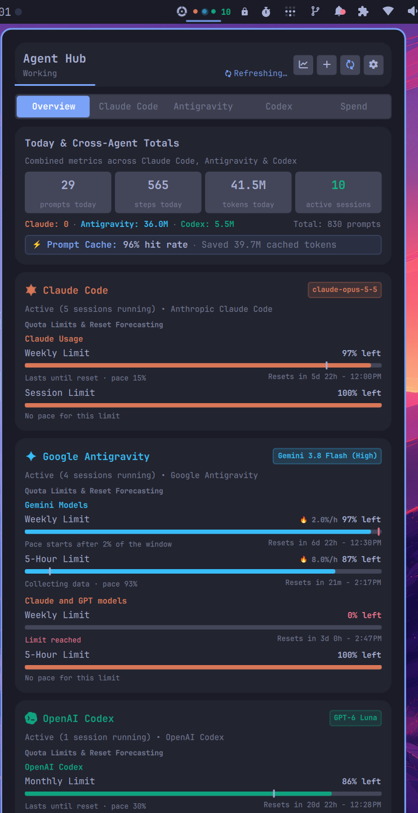
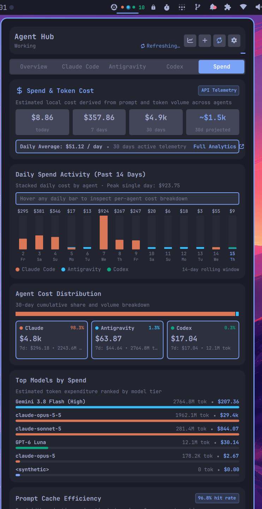
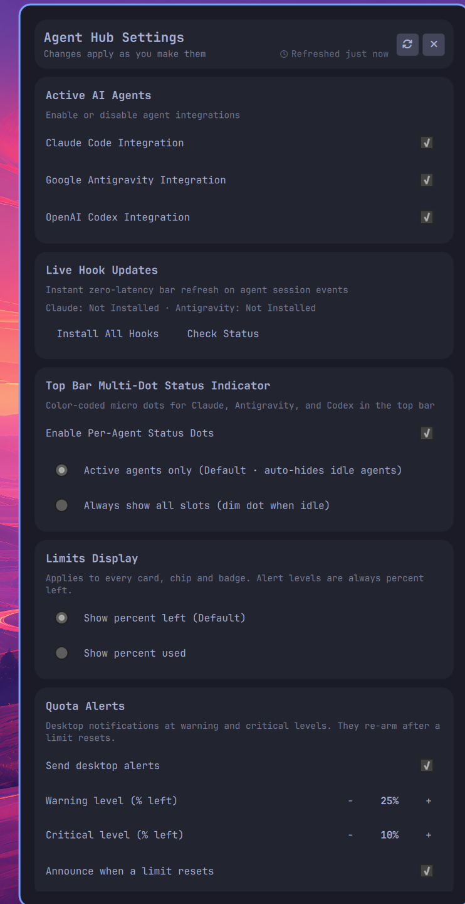
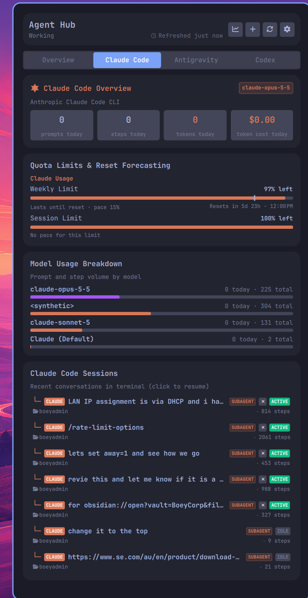
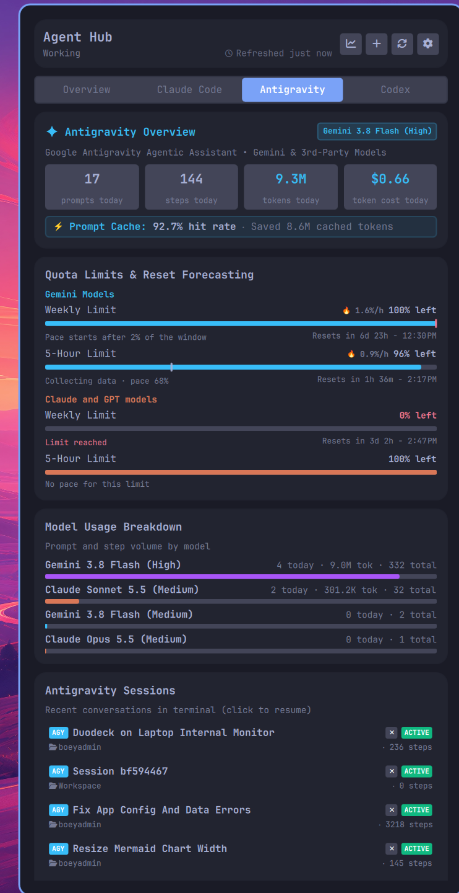
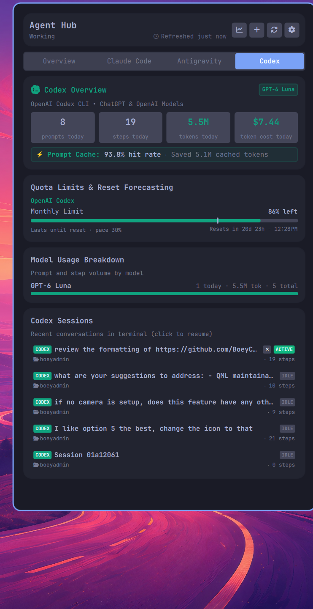
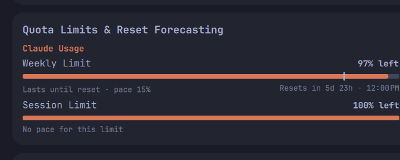
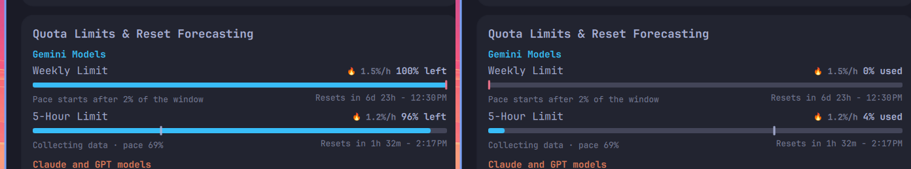

# Agent Hub for Omarchy

**Agent Hub** is a unified multi-agent session monitor, prompt & token telemetry dashboard, quota burn forecasting engine, and interactive launcher for **Claude Code**, **Google Antigravity (AGY)**, and **OpenAI Codex** in the Omarchy top bar.

---

## Screenshots

| Overview Cockpit | Spend & Token Cost | Settings Panel |
| :---: | :---: | :---: |
|  |  |  |

| Claude Code Deep-Dive | Google Antigravity | OpenAI Codex |
| :---: | :---: | :---: |
|  |  |  |

| Limit Bar & Pace Forecasting Anatomy | Used vs. Left Toggle Modes |
| :---: | :---: |
|  |  |

---

## Features

### 1. Unified Status Bar Widget & Menu Bar Quota Chips
- **Themed Vector Icon**: Clean nexus mark dynamically colorized to match your active Omarchy theme foreground color via `MultiEffect`.
- **Global State Pulse**: Color-coded pulse dot reflecting real-time cross-agent execution state:
  - 🟢 **Green (Pulsing)**: Any agent is actively executing or thinking (`Working`).
  - 🔵 **Blue**: Any session is open and waiting for user input (`Waiting`).
  - ⚪ **Transparent**: All agents are idle.
- **Per-Agent Multi-Dot Status Cluster**: Color-coded micro dots next to the bar icon providing instant visual feedback on active agents:
  - 🟠 **Orange (`#D97757`)**: Claude Code
  - 🔵 **Cyan (`#38BDF8`)**: Google Antigravity
  - 🟢 **Emerald (`#10A37F`)**: OpenAI Codex
  - **Pulsing Neon Glow**: Actively working agents pulse with animated halo glows.
  - **Direct Tab Navigation**: Clicking any agent dot in the status bar opens the cockpit directly to that agent's dedicated deep-dive tab.
- **Top Bar Quota Chips**:
  - Live quota badges displayed directly in the Omarchy top bar alongside the hub icon.
  - **Window Pinning (`chipWindow`)**: Pin to `tightest` (most constrained window), `5h` (session), `7d` (weekly), or `monthly`.
  - **Stacked Secondary Limits (`chipSecondLimit`)**: Simultaneously show session and weekly headroom.
  - **Reset Timestamps (`chipShowReset`)**: Show concise countdowns to quota replenishment (e.g. `2h`, `5d`).
  - **Auto-Hide Exhausted Providers (`chipHideUsedUp`)**: Cleanly hide providers at 0% quota.
  - **Overflow Management (`chipMax`)**: Cap visible chips with an automatic `+N` overflow chip.
- **Configurable Dynamic Badge Modes**:
  - `active` (Default): Total concurrent background sessions running across all agents (auto-hides when 0).
  - `prompts`: Total prompts executed today across all agents.
  - `tokens`: Total tokens consumed today (e.g. `124k` or `8.9M`).
  - `cost`: Total rolling token cost today (e.g. `$2.40`).
  - `quota`: Lowest quota remaining percentage across all models and accounts (colored urgent when below threshold).
  - `off`: Minimal bar icon without text badge.

### 2. Tabbed Cockpit: Overview, Agent Deep-Dives, & Spend Analytics
- **Segmented Tab Switcher**: Seamlessly toggle between:
  - **Overview**: Consolidated cross-agent activity, shared quota limits, combined prompt cache efficiency, and normalized tool telemetry.
  - **Claude Code**: Dedicated deep-dive for Claude Code (models, token metrics, session & weekly quota limits, recent sessions).
  - **Antigravity**: Dedicated deep-dive for Google Antigravity (Gemini & 3P Claude/GPT models, token metrics, quota limits, recent sessions).
  - **Codex**: Dedicated deep-dive for OpenAI Codex (GPT models, token metrics, monthly quota limits, recent sessions).
  - **Spend**: Dedicated expenditure analytics dashboard featuring daily stacked bar charts, agent cost distribution, model cost rankings, and prompt cache savings.
- **Fast Keyboard Navigation**: Press `1` for Overview, `2` for Claude Code, `3` for Antigravity, `4` for Codex, `5` for Spend, or use `Tab`.

### 3. Pace Forecasting & Adaptive Projection Model
- **Limit Bar Pace Tick Marker**: Visual tick indicator (`|`) on quota bars marking expected usage relative to the elapsed reset window.
- **Adaptive Rate Weighting**:
  - **Exponential decay** for short windows ($\le 6$ hours) to give higher weight to recent prompt activity.
  - **50/50 blend** of full-window linear average and last 24-hour burn rate for weekly and monthly windows.
- **Pace Classifications**:
  - `runsOut`: Warning that current burn rate will exhaust quota before reset, with estimated time to empty.
  - `lasts`: Confirms burn rate is sustainable through reset with projected remaining headroom.
  - `idle` / `collecting` / `early` / `noUsage` / `limitReached` / `noPace`: Clear context-aware statuses.
- **Used vs. Left Limit Display Toggle (`limitDisplay`)**:
  - Instantly switch all progress bars, chips, and percentage labels between `% left` (headroom) and `% used` (consumption).
  - Alert thresholds and pace mathematics remain normalized to headroom to prevent misconfiguration.

### 4. Actionable Error Notices & Sign-In Workflow
- **Collector Error Diagnostics**: Automatically catches `signin`, `expired`, `rateLimited`, and `offline` collector errors.
- **Notice Cards**: Surfaces exact provider login commands (`claude auth login`, `agy`, `codex login`) directly on the affected tab.
- **One-Click Terminal Sign-In**: Click the **Sign in** button to launch your terminal running the required authentication command.
- **Accelerated Polling**: Automatically polls at high frequency while authentication is pending, snapping back to normal interval upon success.

### 5. Multi-Level Re-Arming Quota Alerts
- **Two-Stage Thresholds**: Configurable **Warning** (default 25%) and **Critical** (default 10%) alert thresholds.
- **Hysteresis (+2%)**: Prevents rapid notification flapping when usage hovers near a boundary.
- **Consolidated Per-Agent Delivery**: Groups bucket alerts so each agent fires at most one notification per crossing.
- **Replenishment & Reset Announcements (`notifyOnReplenish`)**: Sends desktop notification when quota resets or replenishes.
- **Automatic Re-Arming**: Re-arms alert triggers automatically once quota replenishes above warning levels.
- **Flock Concurrency Guard**: Multi-process lock (`quota_alert.lock`) guarantees race-free notification delivery.

### 6. Dedicated Spend Analytics & Graphical Visualizations
- **Summary Stat Cards**: Real-time cards showing today's spend, 7-day cost, 30-day cumulative expenditure, and projected 30-day run rate.
- **14-Day Graphical Stacked Bar Chart**:
  - Interactive histogram showing daily burn stacked by agent (Claude Code in orange, Antigravity in cyan, Codex in emerald).
  - Interactive hover inspection bar displaying exact daily totals and agent breakdown.
  - Daily cost labels and weekday/date indicators.
- **Agent Cost Distribution**:
  - Segmented horizontal proportion bar showing each agent's percentage share of 30-day spend.
  - Side-by-side agent cards displaying monthly expenditure, 7-day cost, total token volume, and overall spend percentage.
- **Top Models by Spend**:
  - Ranked model tier expenditure breakdown with proportional color-coded progress bars.
- **Prompt Cache Efficiency & Avoided Cost**:
  - Cache hit rate gauge, cached tokens read volume, and explanation of API cost avoidance.
- **Live Model Prices**: All costs are API-equivalent estimates (what the same tokens would cost on the pay-per-token API, not what a subscription bills).
  - Prices are fetched once a day in the background from [OpenRouter](https://openrouter.ai/api/v1/models), with [LiteLLM's price list](https://github.com/BerriAI/litellm/blob/main/model_prices_and_context_window.json) as a second source and `scripts/pricing.json` as the offline fallback.
  - Input, output, cache-read, and cache-write tokens each use their own rate. The Spend tab header shows the price source and date.
  - Models that match no price list count as $0 and are named in the Spend tab. Map such a name to a known price id under `aliases` in `scripts/pricing.json`.
  - Check prices from the terminal: `python3 scripts/pricing.py --refresh` or `python3 scripts/pricing.py --model "Gemini 4 Argon (Medium)"`.

### 7. Interactive Session Management & Terminal Launcher
- **Per-Agent Recent Sessions**: Direct terminal resume lists on each agent tab (Claude, Antigravity, Codex) with styled pills and step counts.
- **Quick Terminal Resume**: Click any session card or press `6`–`9` to resume in your terminal (`claude --resume <id>`, `agy --conversation <id>`, or `codex resume <id>`).
- **Clean Process Termination**: Hover over any running session and click the red `` button to terminate the session process cleanly (`SIGTERM`).
- **New Session Launcher**: Click the `` header button or press `n` to launch a new session in your chosen terminal emulator.
- **Terminal Emulator Override**: Configurable terminal command (e.g. `foot`, `ghostty`, `kitty`, `alacritty`, or default `xdg-terminal-exec`).

### 8. Theme Alert Colors & Live Settings
- **Omarchy Theme Harmony**: Bar quota chips and limit progress bars inherit Omarchy theme colors. When limits enter warning or critical states, indicators smoothly adopt the Omarchy theme's urgent color token (`root.urgent`).
- **Instant Live Settings**: Every setting in the configuration panel takes effect immediately without requiring a "Save" action or restarting the shell. Scanner-dependent settings trigger immediate background telemetry updates.

### 9. Zero-Latency Live Hook Updates
- Wires lifecycle events for agents to push instant refreshes to the bar:
  - Claude Code: `SessionStart`, `UserPromptSubmit`, `Stop`, `Notification`, `PermissionRequest`, `SessionEnd`.
  - Google Antigravity: `PreInvocation`, `PostInvocation`, `Stop` via `hooks.json`.
  - OpenAI Codex: Live session tracking via file monitoring and process discovery.
- **One-Click Management**: Toggle or install/remove hooks for agents directly from the settings panel.

---

## Installation

```sh
omarchy plugin add https://github.com/BoeyCorp/agent-hub.git --enable
omarchy restart shell
```

---

## Interactions & Shortcuts

### Mouse Controls
- **Left Click**: Open/close popup panel.
- **Middle Click**: Force immediate telemetry and quota refresh.
- **Right Click**: Toggle in-popup settings view.

### Keyboard Shortcuts (when popup is open)
| Shortcut | Action |
|---|---|
| `1` | Switch to Overview tab |
| `2` | Switch to Claude Code tab |
| `3` | Switch to Antigravity tab |
| `4` | Switch to Codex tab |
| `5` | Switch to Spend tab |
| `6`–`9` | Quick-resume corresponding session in terminal |
| `n` | Launch new terminal session for active agent tab |
| `r` | Force refresh telemetry and quota limits |
| `s` | Toggle between Stats and Settings view |
| `a` / `m` | Open full 30-day interactive analytics window |
| `q` or `Esc` | Close popup panel |

### IPC Commands
The widget registers an IPC target (`boeycorp.agent-hub`), callable via `omarchy-shell`:

| Action | Command |
|---|---|
| Toggle popup | `omarchy-shell boeycorp.agent-hub toggle` |
| Open popup | `omarchy-shell boeycorp.agent-hub open` |
| Close popup | `omarchy-shell boeycorp.agent-hub close` |
| Refresh telemetry | `omarchy-shell boeycorp.agent-hub refresh` |
| Open settings | `omarchy-shell boeycorp.agent-hub settings` |
| Switch active tab | `omarchy-shell boeycorp.agent-hub setTab <overview\|claude\|antigravity\|codex\|spend>` |
| Set limit display mode | `omarchy-shell boeycorp.agent-hub setLimitDisplay <left\|used>` |
| Toggle quota bar chips | `omarchy-shell boeycorp.agent-hub setQuotaChips <true\|false>` |

---

## Configuration

Settings can be adjusted directly in the widget's in-popup settings view (right-click or press `s`) or stored in `~/.config/omarchy/shell.json`:

| Key | Type | Default | Description |
|---|---|---|---|
| `refreshIntervalSec` | integer (10–1800) | `60` | Telemetry refresh rate in seconds (scales to 10s when active) |
| `limitDisplay` | enum | `"left"` | Display limits as remaining headroom (`left`) or consumption (`used`) |
| `badgeMode` | enum | `"active"` | Bar badge mode (`active`, `prompts`, `tokens`, `cost`, `quota`, `off`) |
| `enableMultiDot` | boolean | `true` | Show per-agent color-coded status dots in the status bar |
| `multiDotMode` | enum | `"active"` | Multi-dot display mode (`active` = active agents only, `all` = all slots) |
| `enableQuotaChips` | boolean | `false` | Display individual agent quota chips directly in the top menu bar |
| `chipWindow` | enum | `"tightest"` | Quota window for bar chips (`tightest`, `5h`, `7d`, `monthly`) |
| `chipSecondLimit` | boolean | `false` | Display secondary stacked limit on quota chips |
| `chipShowReset` | boolean | `false` | Display reset countdown time on quota chips |
| `chipHideUsedUp` | boolean | `false` | Automatically hide quota chips when 0% quota is remaining |
| `chipMax` | integer (1–3) | `3` | Maximum number of visible quota chips before `+N` overflow |
| `chipProviderColors` | boolean | `true` | Show colored provider brand dots on quota chips |
| `enableQuotaAlerts` | boolean | `true` | Send desktop notifications when quota falls below threshold |
| `quotaWarnThreshold` | integer (5–50) | `25` | Warning alert threshold percentage |
| `quotaCritThreshold` | integer (1–25) | `10` | Critical alert threshold percentage |
| `notifyOnReplenish` | boolean | `true` | Send notification when quota limits reset or replenish |
| `enableClaude` | boolean | `true` | Enable Claude Code agent integration |
| `enableAntigravity` | boolean | `true` | Enable Google Antigravity agent integration |
| `enableCodex` | boolean | `true` | Enable OpenAI Codex agent integration |
| `defaultTab` | enum | `"overview"` | Default tab on popup open (`overview`, `claude`, `antigravity`, `codex`, `spend`) |
| `terminalCommand` | string | `""` | Terminal emulator command override (blank for `xdg-terminal-exec`) |
| `recentSessionsLimit` | integer (3–15) | `6` | Initial number of recent sessions to display |

---

## Development & Testing

Run the automated test suite verifying scanner contracts, pace forecasting, alert engines, spend calculations, token extraction, and live hooks:

```sh
python3 -m unittest discover -s tests -v
```

---

## License

MIT © BoeyCorp & contributors
